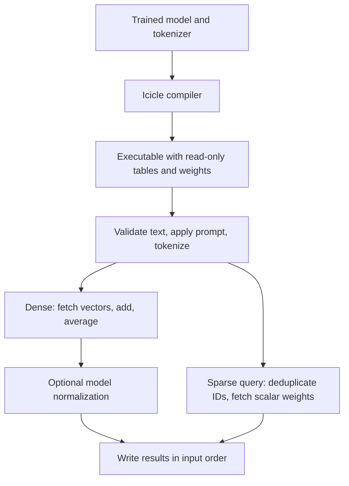

# Icicle

Icicle compiles a supported Hugging Face static text encoder into a native C++ command line program. The generated executable contains its tokenizer tables and weights: give it one UTF-8 text per line on standard input, and it writes one dense or sparse result for each line. It needs no model files, Python, or network access when running. It does link to the platform's ICU libraries.

## Quick start

Install a C++20 compiler, CMake 3.20+, ICU development libraries (`uc` and `i18n`), and `curl`. On Debian or Ubuntu:

```sh
sudo apt-get install build-essential cmake libicu-dev curl
cmake -S . -B build -DCMAKE_BUILD_TYPE=Release
cmake --build build --parallel
ctest --test-dir build --output-on-failure
```

On macOS with Homebrew:

```sh
brew install cmake icu4c
cmake -S . -B build -DCMAKE_BUILD_TYPE=Release \
  -DCMAKE_PREFIX_PATH="$(brew --prefix icu4c)"
cmake --build build --parallel
ctest --test-dir build --output-on-failure
```

Build a dense encoder and stream queries through it:

```sh
./build/icicle inspect sentence-transformers/static-retrieval-mrl-en-v1
./build/icicle build sentence-transformers/static-retrieval-mrl-en-v1 --output ./embed
printf 'hello world\nsecond query\n' | ./embed
```

The output is JSON Lines, with one `{"embedding":[...]}` object per input line. A build from a public Hub model resolves the requested revision to a commit and caches source files under `$XDG_CACHE_HOME/icicle` or `~/.cache/icicle`.

For an inference-free SPLADE query encoder:

```sh
./build/icicle build monkeypostulate/inference-free-splade-distilbert-base-uncased-nq \
  --route query --output ./sparse-query
printf 'hello world\n' | ./sparse-query
```

Its output contains sorted token IDs and their nonzero weights: `{"indices":[...],"values":[...],"dimension":N}`. Repeated query terms contribute their weight once.

## Supported models

| Component | Supported form |
| --- | --- |
| Dense model | Sentence Transformers `StaticEmbedding`, optionally followed by `Normalize` |
| Sparse model | `SparseStaticEmbedding` on the **query route** of a Sentence Transformers `Router`; the document route is not compiled |
| Tokenizer | BERT normalizer + `BertPreTokenizer` + WordPiece, or a null normalizer + ByteLevel BPE with standard merge rules |
| Weights | One float32 safetensors tensor, with rows matching tokenizer IDs |
| Platforms | Linux ELF and macOS Mach-O builds; C++20 and ICU required |

Icicle rejects unsupported graph modules, tokenizer components, BPE options, or weight formats during inspection or build. In particular, this release does not implement Unigram, Metaspace, arbitrary BPE pre-tokenizer sequences, BPE dropout, byte fallback, or float16 weights. Sparse transformer document encoders are outside the static query route.

`icicle build MODEL --output FILE` accepts `--revision REV` to pin a Hub revision, `--local DIRECTORY` to build from a local model snapshot without Hub access, and `--cxx COMPILER` to select the compiler for the generated executable. `icicle inspect MODEL` accepts `--revision` and `--local` too.

## Optional compact builds

Dense models can retain the first N coordinates of every weight row with
`--dimension N`. This is useful for Matryoshka models such as StaticMRL; the
smaller representation has a different retrieval quality profile. `--quantize
int8` stores signed 8-bit weights with one float32 scale per row; accumulation
and output stay float32. Both options are opt-in, and `--info` reports the source
and output dimensions and weight dtype. Source checkpoints still require F32
safetensors. Sparse query models do not accept these options.

```sh
./build/icicle build sentence-transformers/static-retrieval-mrl-en-v1 \
  --dimension 512 --quantize int8 --output ./embed-compact
```

The default build preserves the original float32 weights and full dimensions.

## Generated executable

Each input line is one query. The executable validates UTF-8, applies the model's saved default prompt when present, tokenizes the text, and emits one result in input order. `--prompt TEXT` overrides that prompt. A line can be at most 16 MiB; a batch can hold at most 64 MiB of input text and 256 MiB of dense results. The effective batch size is reduced when needed to respect the result limit.

Useful options:

```sh
./embed --info                       # Model, revision, kind, dimension, prompt
printf 'hello\n' | ./embed --tokens  # Token IDs as JSON Lines
./embed --format binary < queries.txt > embeddings.bin
./embed --format binary --threads 4 --batch-size 256 \
  < queries.txt > embeddings.bin
```

Binary output is little-endian and has no file header. A dense record is `dimension` consecutive float32 values; use `--info` to learn its fixed size. A sparse record begins with a uint32 pair count, followed by that many `(uint32 token_id, float32 weight)` pairs. `--tokens` is available with JSON output only.

By default, the program processes and emits each line as it arrives. `--threads N` enables a worker pool when `N > 1`; `--batch-size B` also enables batching and defaults to 256 when omitted. Workers share read-only weights and tokenizer tables while keeping separate scratch buffers. Workers take small contiguous chunks as they finish, so faster cores can process more queries. Batch mode preserves input order, flushes a partial batch at end of input, and may wait for a batch to fill before writing output. The maximum batch size is 65,536 lines. `--pipeline` overlaps encoding with writing the previous batch and reading the next one, using up to three reusable batch buffers. Input reading and output writing remain on the main thread. This can increase output latency and memory use, and very large pipeline batches can be slower. For an interactive stream, use the default mode or a small batch size.

```sh
./embed --format binary --threads 32 --batch-size 4096 --pipeline \
  < queries.txt > embeddings.bin
```

`--benchmark` reads the corpus into memory before timing, reuses the same worker
pool, and emits a JSON timing report instead of embeddings. It includes
encoding, result stores, dispatch and any output-buffer growth; it excludes
input parsing, UTF-8 validation, pool startup, serialization and a final
checksum. An optimizer barrier retains every batch's output stores. There is
one warmup followed by three measured runs by default.

```sh
./embed --benchmark --threads 32 --batch-size 65536 \
  --benchmark-repeat 100 --benchmark-runs 3 < queries.txt
```

The corpus is limited to 256 MiB of text and 10 million lines; repetitions may
create at most 10 million query references. These encoding-only figures should
be reported separately from end-to-end CLI throughput.

## How it works

### Building the executable

Icicle reads an already trained model from the Hub or a local snapshot. It
checks the module graph, tokenizer configuration, and safetensors shape, then
packs the model weights and compiled tokenizer tables into read-only binary
data. The linker embeds that data into a model-specific C++ executable.

The generated code knows the model kind, embedding dimension, normalization
setting, and weight format at compile time. The C++ compiler can eliminate
unused branches and optimize the arithmetic loops. The weights remain data
in the executable; running it requires no checkpoint parsing or Python model
initialization. ICU remains a system-library dependency. Executables are built
for their target OS and architecture.



### Dense static embeddings

A dense model stores one fixed vector for every token ID. Tokenization might
turn `hello world` into two IDs; the runtime fetches those two vectors, adds
their coordinates, and divides by two. For example, vectors `[2, 0]` and
`[0, 4]` produce `[1, 2]`. A repeated token contributes its vector again.
An empty token sequence produces zeros. If the saved model includes
`Normalize`, the final vector is divided by its length.

Each token's vector is independent of its surrounding words. After tokenization,
mean pooling does not encode token order. The runtime performs table lookups
and arithmetic without a transformer forward pass. Document and query vectors
can then be compared by the retrieval system; Icicle itself only emits vectors.

### Inference-free SPLADE queries

The supported sparse query model stores one learned scalar per vocabulary
token. The runtime tokenizes the query, sorts and deduplicates its IDs, and
emits each ID with its nonzero scalar. For example, `hello hello world` with
weights `hello: 1.5` and `world: 2.5` emits those two pairs once each.

The conceptual vector has one coordinate per vocabulary token, but output
stores only the active `(token_id, weight)` pairs. Its vocabulary-sized dense
vector is never constructed. There is no averaging and no repeated-term sum.

"Inference-free" describes this query path: it still tokenizes and reads
learned weights, but runs no neural network. The model's document route can
require a transformer. Icicle compiles only the static query route; compatible
document vectors and the retrieval index must be supplied separately.

### Where the speed comes from

- **Small computation:** dense encoding reads and averages token vectors;
  sparse encoding reads a few scalar weights. Neither supported path runs
  attention layers or large neural matrix multiplications at query time.
- **Compiled lookup tables:** WordPiece follows a direct-offset trie. Each
  character advances through array indexes, with no runtime vocabulary hash
  table or substring allocation for a successful match. ByteLevel BPE uses a
  merge offset index and a shared 512 KiB initial byte-pair table; long pieces
  use a heap to avoid repeatedly scanning every candidate merge.
- **ASCII and SIMD:** SSE2 on x86 or NEON on ARM scans 16 bytes at a time to
  detect ASCII. ASCII normalization and splitting use a direct byte path.
  Unicode still uses ICU for correctness. Dense row-addition and division
  loops permit compiler vectorization across coordinates; tokenization as a
  whole is not one SIMD operation.
- **Reused memory:** workers retain tokenizer scratch space and output buffers.
  They share one read-only model and tokenizer. Each worker clears its own
  output rows, avoiding a second zero-fill on the input thread. Scratch headers
  occupy separate cache lines to reduce contention between workers.
- **Batching and parallelism:** a persistent worker pool handles independent
  queries, claiming small contiguous chunks. Large batches spread coordination
  costs over more queries and let faster cores do more work. Pipelining overlaps
  encoding with the main thread's input and output work, using three buffers.
- **Binary output:** dense batches write contiguous float32 results. Sparse
  batches pack pairs into a reusable buffer capped at 1 MiB. This avoids the
  decimal conversion and punctuation needed for JSON.
- **Optional smaller weights:** int8 reduces weight storage to approximately
  one quarter, plus row scales; the runtime converts values while accumulating
  in float32. Fewer dimensions reduce both arithmetic and output size. Both
  changes need retrieval quality evaluation.

The [batch report](bench/BATCH_OPTIMIZATIONS.md) records 3.77M dense float32,
4.56M dense int8, and 9.37M sparse CLI queries/s on an i9-13900HX. Its corpus
contains short GooAQ questions repeated across runs, and binary output goes
to `/dev/null`. Saving results or sending them to a consumer adds costs.
In-memory measurements exclude input loading, validation, and serialization;
they should be compared separately. These are aggregate throughput figures
across workers, not single-query latency guarantees.

LTO, fixed worker assignments, and tokenizer/pooling fusion were discarded
after evaluation. Historical measurements remain in the reports; their
experimental runtime paths and build switches have been removed.

## Tests and benchmarks

`ctest --test-dir build --output-on-failure` runs offline end-to-end fixtures for dense and sparse models, WordPiece and BPE tokenizers, binary output, and batching. The [build workflow](.github/workflows/build.yml) runs the same tests on Linux and macOS and checks the installed compiler.

Benchmark reports include their model revisions, corpus checksum, machine, output format, and reproduction commands:

- [Detailed architecture, performance, and validation report](docs/ICICLE_REPORT.md)
- [Batch scheduling, pipelining and compact model experiments](bench/BATCH_OPTIMIZATIONS.md)
- [WordPiece dense and sparse throughput](bench/FINAL_RESULTS.md)
- [ByteLevel BPE throughput and optimization](bench/BPE_RESULTS.md) — its RoBERTa tokenizer is real; its embedding weights are synthetic.
- [Batching investigation](bench/BATCHING.md) and [earlier optimization experiments](bench/RESULTS.md)

[PLAN.md](PLAN.md) describes the architecture and remaining compatibility work. The vendored JSON header retains its own [MIT license](include/nlohmann/LICENSE.MIT).
